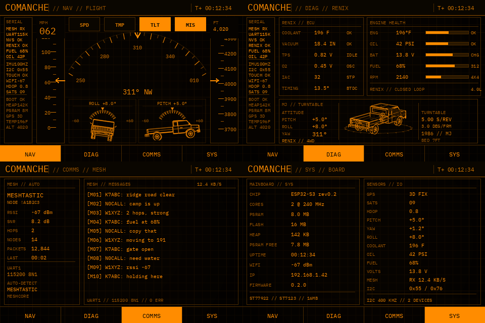

# COMANCHE // MJ-4.0 TERRAIN MONITOR

An amber-phosphor vehicle terminal for the Hosyond / LCDWiki **ES3C35P**
(ESP32-S3, 320x480 ST77922 QSPI panel, capacitive touch).  Boxy 1980s pickup
energy, 1980s sci-fi interface.



## What's on screen

- **Startup** — a Street Fighter-style title card. `Comanche` is set in the
  Racing in the Rain brush face, angled -6 degrees, in amber with a red drop
  shadow; `Game over` sits below in BlexMono Bold. A jagged amber/red paint edge
  wipes the art in over about a second, the card holds, and the dashboard
  appears at about the 5-second mark.
- **NAV** — a ribbed 20 MPH speed tape, a 100 ft ribbed altitude tape, a
  120-degree compass arc (36 pre-rendered A8 frames selected by heading) under
  a fixed pointer, bordered bold annunciators (SPD, TMP, TLT, MIS), a mission
  clock in the top-right header, and two attitude gauges: a front-view
  wireframe rolling with tilt and a side-view wireframe pitching. GPS, the
  local/Zulu clock, ATMOS and the old circular compass are gone.
- **DIAG** — live Renix ECU parameters (coolant, vacuum, TPS, O2, IAC, timing),
  five engine-health bar meters, and a 394x88 turntable band with the rotating
  Jeep Comanche, pitch/roll/yaw readouts and a fixed measurement ring.
- **COMMS** — Meshtastic/MeshCore auto-detect banner, node stats, and a
  simulated message feed from a second ESP32.
- **SYS** — real board health (chip, PSRAM, flash, internal heap, PSRAM free,
  uptime, WiFi RSSI, IP, firmware), plus sensor/IO status.  The heap, PSRAM and
  IP values come from the running firmware rather than fixed strings.
- **Serial monitor** — a 56 px, full-height three-band waterfall on the far left
  of NAV and DIAG, newest at the top: newest amber, middle mid-amber, oldest
  dim.
- **Rotating wireframe Jeep Comanche (MJ)** — dimensioned from the long-bed MJ
  specs, 120 pre-rendered 140x78 A8 frames, 3.0 degrees per frame, one
  revolution every 5 s (24 fps), DIAG only.  Starts when DIAG opens and stops
  when it leaves.
- **Four full-width touch buttons** across the bottom edge.

Everything is drawn with **BlexMono** (IBM Plex Mono, Nerd Fonts build) at a
9-18 px scale, in one warmed amber palette (`#FF8C00`) over a near-black grid
with a soft edge vignette. The startup title is baked into the startup art with
the Racing in the Rain brush face.

## Performance at a glance

The full image is **4.45 MB** (60.7% of the 7 MB OTA slot) versus 6.05 MB for
the previous build.  The biggest win is storing every single-colour wireframe
as an **8-bit alpha mask** and letting LVGL recolour it amber: the 36 compass
arcs alone dropped from 3.64 MB to 1.21 MB.  The truck gained twice the frames
and 3.4x the pixel area while the whole app still shrank by 26%.

The panel stays at **40 MHz**, comfortably below the ST77922's 62.5 MHz QSPI
write limit; PSRAM stays at its rated **80 MHz**; the framework is built with
`-O2`/PERF, assertions disabled, QIO 80 MHz flash and a 64 KB data cache.  All
the update loops are change-detected, hidden pages are skipped, and the
turntable timer is stopped when DIAG is not visible.  Details and the measured
numbers are in [docs/PERFORMANCE.md](docs/PERFORMANCE.md).

## Quick start

```bash
cp firmware/secrets.yaml.example firmware/secrets.yaml   # fill in Wi-Fi
python3 -m venv .venv
.venv/bin/pip install pillow numpy
./scripts/verify.sh --compile                            # local render + tests + build
./scripts/esphome.sh run comanche-monitor.yaml --device /dev/ttyACM0
```

The first flash must be over USB; later builds OTA. Full instructions,
partition map, recovery and the local no-flash workflow are in
[docs/BUILD.md](docs/BUILD.md).

> First boot after flashing: if the screen is black, **unplug and replug** the
> USB-C cable. The panel's reset is tied to CHIP_PU.

## Local testing (no flash)

```bash
./scripts/verify.sh              # regenerate assets, run tests, validate config
./scripts/verify.sh --no-render  # tests + validation only
./scripts/verify.sh --compile    # also run the ESPHome build
```

`tools/preview.py` writes 1:1 mocks of all four pages to `docs/ui-nav.png`,
`ui-diag.png`, `ui-comms.png`, `ui-sys.png` and `ui-screens.png`.  The host
tests check frame counts, dimensions, alpha coverage, unique compass frames,
the published model dimensions, the projection fit and the manifest paths.

## Hardware

| | |
|---|---|
| MCU | ESP32-S3R8, 240 MHz, 16 MB flash, 8 MB octal PSRAM |
| Panel | ST77922, 320x480 portrait, QSPI 40 MHz, RGB565 |
| Touch | ST77922 touch half, I2C `0x55` |
| Backlight | GPIO41, PWM |
| USB | native USB-Serial/JTAG |

Pinout, quirks and the factory backup are documented in
[docs/HARDWARE.md](docs/HARDWARE.md); the full driver inventory (both the
factory firmware and this build) is in [docs/DRIVERS.md](docs/DRIVERS.md).

## Repository layout

```
firmware/
  comanche-monitor.yaml       ESPHome config: hardware, UI, fake data engine
  comanche_ui.h               allocation-free label/bar/rotation helpers
  st77922-init-sequence.yaml  63-entry ST77922 power-up table
  partitions.csv              2 x 7 MB OTA + 1.9 MB FFat
  fonts/                      BlexMono TTF (OFL 1.1)
  assets/
    images.yaml               generated image manifest (A8 masks + two colour cards)
    truck/                    120 wireframe frames, 140x78 (generated)
    gauges/                   compass arcs, attitude faces, front/side views
    ui-background.png         grid + vignette background (generated)
    startup.png               baked startup title card (generated)
    paint_edge.png            startup wipe edge (generated)
docs/
  HARDWARE.md  DRIVERS.md  BUILD.md  BACKUP.md  UI.md  RENIX.md
  PERFORMANCE.md              bus/asset/render budget, measured build numbers
  MODEL.md                    MJ dimensions, projection and turntable notes
  ui-preview.png              NAV mock (legacy name)
  ui-screens.png              all four pages
  truck-contact-sheet.png     all 120 truck frames
tools/
  comanche_model.py           dimensioned MJ model + hidden-line renderer
  render_truck.py             model -> 120 frames + attitude views
  render_background.py        grid + vignette generator
  render_gauges.py            compass arcs + gauge faces (A8)
  render_startup.py           startup art and paint edge
  gen_assets.py               assets -> ESPHome image manifest
  preview.py                  all four pages, Pillow
  test_project.py             host regression tests
  palette.py                  single source of colour truth
racing_in_the_rain/           startup display font (personal-use license)
backup/
  factory-esp32s3-16MB.bin    untouched factory flash
```

## Adding the GPS module later

Wire the module's TX to **GPIO44** (and RX to GPIO43 if you want to configure
it), enable the `uart:` + `gps:` block at the bottom of
`firmware/comanche-monitor.yaml`, then replace the simulated `g_lat`/`g_lon`
assignments with the `gps` sensors. The labels and formatting already handle
negative hemispheres.

## Known limits

- Vehicle data, log lines and GPS are **simulated** — this is a dashboard shell.
  The truck has Renix management, so there is no OBD-II/CAN stream to read; see
  [docs/RENIX.md](docs/RENIX.md).
- The BME280/ATMOS block was removed from NAV after the sensor failed to respond
  at `0x76` or `0x77`; GPS status remains on SYS.
- Audio (ES8311), microSD and the WS2812 are not enabled; their 3.5" pin map is
  unverified.
- The truck animation is pre-rendered. `tools/comanche_model.py` is the source;
  runtime 3D was traded for guaranteed frame timing and zero CPU cost on the
  render task.  The turntable, pitch and roll views are all dimensioned from
  the published MJ long-bed specs; see [docs/MODEL.md](docs/MODEL.md).
- The startup card is the only full-colour raster asset besides the page
  background.  Every other wireframe is an A8 mask recoloured by LVGL.

## Provenance

Board identity and the driver inventory were established from the board itself
(USB descriptors, `esptool`, and a full flash dump), not from the marketplace
listing — which claims 240x320 and is wrong. The ST77922 init sequence and the
rotation/touch contract come from the ES3C35P reverse-engineering notes; see the
comments in `st77922-init-sequence.yaml`.

Fonts: BlexMono Nerd Font Mono, OFL 1.1. The startup title uses Racing in the
Rain by BlackFridayFont, free for personal use; see the license text in
`racing_in_the_rain/`.
